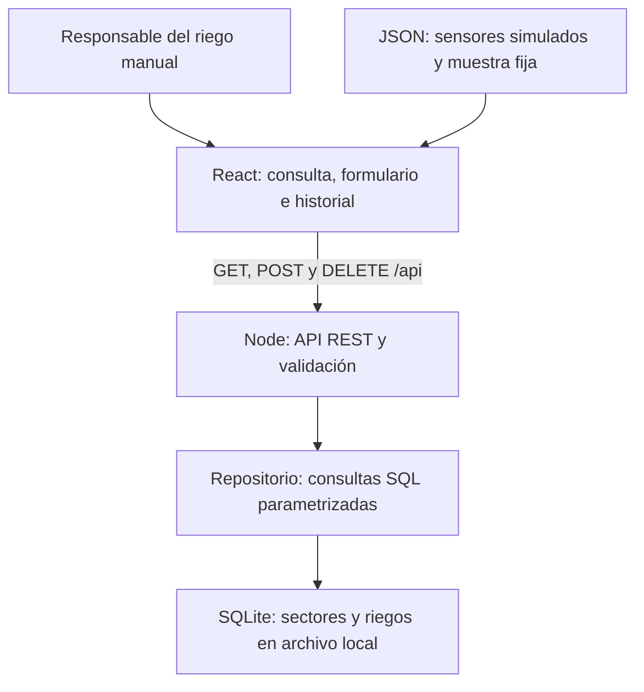

# Arquitectura final

Frontend: la parte visible. Recibe sectores y riegos desde la API; presenta el origen, calcula el volumen estimado y confirma eliminaciones. API REST local: servicio HTTP que recibe pedidos y devuelve JSON y códigos de estado. Endpoints: rutas que identifican qué recurso consultar, crear o eliminar. El prefijo /api permite servir ambas partes desde el mismo origen.

Backend: valida el contrato, normaliza fechas a UTC y escribe en SQLite antes de devolver 201. El sector se toma de la ruta y no se admite en el cuerpo. Se rechazan propiedades adicionales, JSON inválido, valores negativos, fechas imposibles y discrepancias de volumen. La API no controla hardware.

Persistencia: SQLite guarda datos en un archivo, independiente de la memoria del proceso. Las semillas se insertan en una transacción inicial, identificada por user_version=1. La clave foránea impide riegos asociados a un sector inexistente. El índice (sector_id,inicio) ayuda a consultar su historial. Al cerrar el servidor se cierra la conexión. DELETE limita la operación al ID y sector solicitados.

| Tabla | Clave y relación | Datos |
|---|---|---|
| sectores | id (PK) | número, cultivo, humedad simulada, umbrales y estado |
| riegos | id (PK), sector_id (FK) | inicio UTC, duración, caudal opcional, volumen, observación y origen |

Los umbrales son demostrativos: no se validaron agronómicamente. Registrar agua no cambia automáticamente la humedad simulada. La recomendación visual señala un umbral; la decisión y ejecución siguen siendo humanas.

Cambios frente al avance: arrays → repositorio SQLite; DELETE implementado; origen de semillas explícito; historial filtrado por fecha real; volumen coherente; fallos de API visibles. El frontend estático heredado no reemplaza al servidor Node.

## Meteorología opcional
Node consulta la API HTTPS de Open-Meteo usando coordenadas de `.env.weather`, valida series/unidades y guarda la respuesta y valores normalizados en tablas nuevas del mismo SQLite. React consulta `/api/meteorologia`; sólo recibe valores y fechas, sin coordenadas. `?history=1` recupera hasta 30 versiones guardadas de la configuración vigente. POST actualiza; GET sólo lee. El módulo agrega tablas sin alterar sectores, riegos ni user_version.
